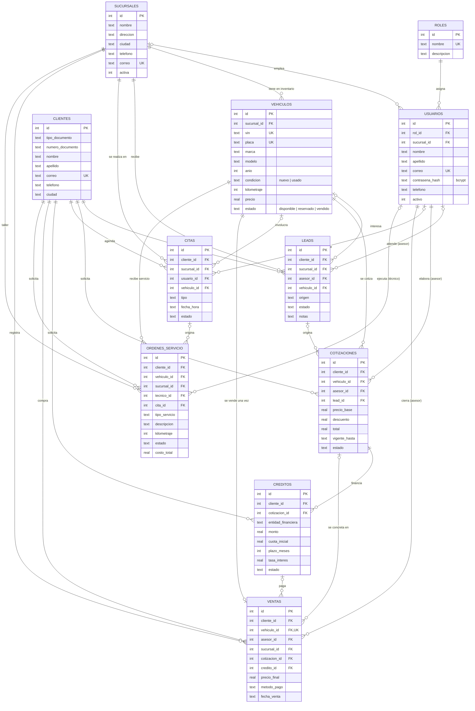

# Diagrama entidad-relación

Se visualiza directamente en GitHub, GitLab o VS Code (extensión *Markdown Preview Mermaid Support*).
También se puede pegar en https://mermaid.live para exportarlo como PNG/SVG.

